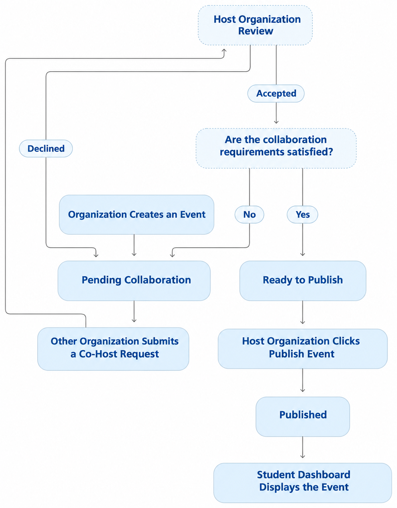

# CoHost

**CoHost** helps student organizations plan events together and lets students discover events once they are officially published. Organizations can propose events, receive co-hosting requests, review potential partners, and decide when an event is ready for students to see.

## How It Works

CoHost separates **collaboration** from **publication**. Creating an event does not immediately make it visible on the Student Dashboard.

### Event Collaboration and Publication Workflow

1. **Create an event.** A host organization creates an event. The event enters the **Pending Collaboration** stage when collaboration begins.
2. **Receive co-host requests.** Other organizations can submit requests to collaborate on that event.
3. **Review requests.** The host organization reviews each request and either **accepts** or **declines** it. Declined requests do not proceed as collaborations; after acceptance, the host evaluates whether the event's collaboration requirements have been satisfied.
4. **Check collaboration requirements.** If the requirements are **not yet satisfied**, the event remains in **Pending Collaboration**. Once the requirements are met, the event can move to **Ready to Publish**.
5. **Publish explicitly.** The host organization clicks **Publish Event**. Accepting a co-host request does **not** automatically publish the event.
6. **Make the event discoverable.** The event becomes **Published** and appears on the **Student Dashboard**.

### Workflow Diagram

The original collaboration and publication flowchart is embedded below **without any visual modifications**.



## Key Principles

- **Host-controlled publication:** The host decides when a collaboration is complete and manually publishes the event.
- **Request-based collaboration:** Potential co-hosts submit requests that the host can accept or decline.
- **Clear event status:** The workflow distinguishes events still seeking collaborators from events ready to be published and those already published.
- **Student-facing visibility:** Events appear on the Student Dashboard **only after publication**.

## Example

A campus club creates an event and opens it for collaboration. Another organization offers to co-host, so the host reviews the request. If the host accepts but the collaboration requirements are not yet met, the event stays in **Pending Collaboration**. When those requirements are fulfilled, the host moves forward and clicks **Publish Event**. Only then does the event appear on the **Student Dashboard**.

## Live Application

[Open CoHost](https://cohost-8fdc0.web.app)

## Development

This repository uses React, TypeScript, Vite, and Firebase. For local development, install dependencies and start Vite with the V2 publication workflow enabled:

```bash
npm install
VITE_PUBLICATION_V2_ENABLED=true npm run dev
```

Run the available checks before proposing changes:

```bash
npm run build
npm run lint
npm test -- --run
```

> **Firebase caution:** A local development server may still connect to the production Firebase project unless explicitly configured to use emulators. Avoid creating or altering real project data during exploratory testing.

## Team Collaboration

Submit changes through a feature branch and a GitHub pull request. Review and test changes before merging them into `main`. Coordinate Firebase deployments with the team so that one deployment does not unexpectedly replace another version of the website.
